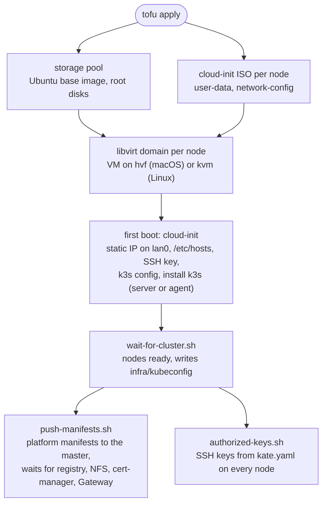

# How it works

## Overview



## Resources

| Resource | Count | Purpose |
|---|---|---|
| `random_password.k3s_token` | 1 | Shared secret workers use to join |
| `libvirt_pool.cluster` | 1 | Directory pool for all images |
| `libvirt_volume.base` | 1 | Ubuntu cloud image, downloaded once |
| `libvirt_volume.root` | 3 | Copy-on-write disk per node on top of the base image, grown to `disk_gb` |
| `libvirt_network.cluster` | 0–1 | Only with `network_mode = "nat"` |
| `libvirt_cloudinit_disk.init` | 3 | Per-node cloud-init ISO |
| `libvirt_domain.node` | 3 | The VMs |
| `terraform_data.cluster_ready` | 1 | runs `wait-for-cluster.sh`: nodes ready, writes `infra/kubeconfig` |
| `local_sensitive_file.manifest` | 6–7 | rendered platform manifests in `infra/.manifests/` |
| `terraform_data.platform` | 1 | runs `push-manifests.sh`: copies them to the master and waits for the platform |
| `tls_*`, `local_file.ca_certificate` | 6 | cluster CA and Gateway certificate |

The provider is `dmacvicar/libvirt` **0.8.3**. Version 0.9 and later are a complete rewrite with a different schema. Upgrading means rewriting `main.tf`.

## Node addressing

Each node gets a fixed IP and MAC, worked out from `network_cidr` and `ip_offset`:

| Node | IP | MAC |
|---|---|---|
| master | `cidrhost(cidr, ip_offset)` | `52:54:00:6b:38:<ip_offset as hex>` |
| worker-N | `cidrhost(cidr, ip_offset + N)` | `52:54:00:6b:38:<ip_offset+N as hex>` |

Inside the VM, netplan matches the NIC by MAC, renames it to `lan0` and sets the IP statically. k3s uses `lan0` for Flannel (`flannel-iface`) and the node IP. The interface name is the same on every host type.

## k3s setup

cloud-init writes `/etc/rancher/k3s/config.yaml` before running the official installer, so the settings survive upgrades.

**Master** (`k3s server`):

- `node-ip`, `flannel-iface: lan0`
- `tls-san`: master IP and hostname, so the kubeconfig works from outside
- `write-kubeconfig-mode: "0644"`
- taint `node-role.kubernetes.io/control-plane=true:NoSchedule`, unless `master_schedulable = true`

**Workers** (`k3s agent`):

- `server: https://<master-ip>:6443` and the shared token
- the agent retries until the master is up, so no explicit wait is needed

## Platform manifests

Cluster add-ons are plain Kubernetes manifests in `infra/templates/`. OpenTofu renders them into `infra/.manifests/` (git-ignored: they contain keys and the DNS token), and `scripts/push-manifests.sh` copies them over ssh to `/var/lib/rancher/k3s/server/manifests/` on the master as `tofu-*.yaml`. k3s applies every file in that folder and re-applies it when it changes; when a `tofu-*.yaml` disappears, k3s removes its resources.

They are deliberately **not** part of cloud-init: a change to cloud-init rebuilds the VMs, a change to a manifest only re-runs `terraform_data.platform`.

| Manifest | Contents |
|---|---|
| `dashboard.yaml` | Headlamp (see below) |
| `registry.yaml` | image registry on the master |
| `storage.yaml` | csi-driver-nfs, StorageClass `nfs` |
| `gateway.yaml` | Traefik Gateway API, cluster CA certificate, `public-gateway` (http→https redirect, `https` on the node IPs) |
| `mariadb-operator.yaml` | mariadb-operator |
| `cert-manager.yaml` | cert-manager, Hetzner DNS webhook |
| `acme.yaml` | only while `acme:` is in `../kate.yaml` (or a token is passed): token Secret, Let's Encrypt ClusterIssuers |

Per-site objects are not here: `./kate deploy` creates them in each site's namespace (see below).

## Sites and routing

Each folder in `projects/` is one site with its own namespace, image (`<registry>/<name>`) and Helm release `typo3`. All sites share the nodes, the registry, NFS, the operators, cert-manager and Traefik.

```
browser ──:443──▶ Traefik (websecure, port 8443 in the Gateways)
                  ├─ SNI kate.example.org ─▶ Gateway <ns>/site (site-tls, Let's Encrypt) ─▶ HTTPRoutes typo3, media of <ns>
                  ├─ SNI shop.example.org ─▶ Gateway <ns2>/site …
                  └─ IP address (no SNI) ──▶ gateway-system/public-gateway https (cluster CA) ─▶ routes of the one node-IP site
browser ──:80───▶ public-gateway http ─▶ redirect to https
```

| Object | Namespace | Created by |
|---|---|---|
| Gateway `public-gateway`, GatewayClass `traefik`, Secret `gateway-tls` | `gateway-system` | `infra/` |
| ClusterIssuers `letsencrypt`, `letsencrypt-staging`, a Secret `dns-<name>` per DNS provider | cluster / `cert-manager` | `infra/`, while `acme:` is set |
| Certificate `wildcard` (Secret `wildcard-tls`), ReferenceGrant `site-<namespace>` per site | `gateway-system` | `./kate deploy`, with `acme.wildcard` |
| Gateway `site`, Certificate `site` (Secret `site-tls`) | the site's | `./kate manifests`, only with a `domain` |
| HTTPRoute `media` | the site's | `./kate manifests` |
| HTTPRoute `typo3` | the site's | the chart; `parentRefs`, `hostnames` from `./kate values` |

A site with a domain attaches its routes to its Gateway `site` with that hostname. The node-IP site (`nodeIPs: true`, or no domain) also attaches to `public-gateway`, without a hostname. Its namespace carries the label `gateway-access: public`, and only one site may have it. Each namespace records its site in the annotations `typo3-kate/project` and `typo3-kate/domain`, which `./kate deploy` checks before it deploys.

## Dashboard

`dashboard.yaml` contains:

- a `HelmChart` object: k3s's built-in Helm controller installs the Headlamp chart from `kubernetes-sigs.github.io/headlamp`, with `service.type: NodePort`. No `helm` binary is needed.
- ServiceAccount `dashboard-admin`, a `cluster-admin` ClusterRoleBinding and a long-lived token Secret for logging in

## macOS specifics

libvirt's domain XML is patched with an XSLT stylesheet (`templates/domain.xsl.tftpl`) where provider 0.8.3 has no option:

| Patch | Why |
|---|---|
| cloud-init CD-ROM `ide` → `scsi` | the aarch64 `virt` machine has no IDE bus |
| drop `<pae/>`, `<apic/>` | x86-only features the provider always adds |
| add `<gic version="3"/>` | HVF cannot emulate GICv2, libvirt's default |
| `<qemu:commandline>` with `-netdev stream,…socket_vmnet` and a `virtio-net-pci` NIC at `pcie.0` slot `0x1f` | libvirt has no interface type for socket_vmnet |

Other aarch64 settings come from normal provider options: `machine = "virt"`, UEFI firmware plus a per-VM NVRAM file, and `type = "hvf"`.

On Linux x86_64 no XSLT is applied.
