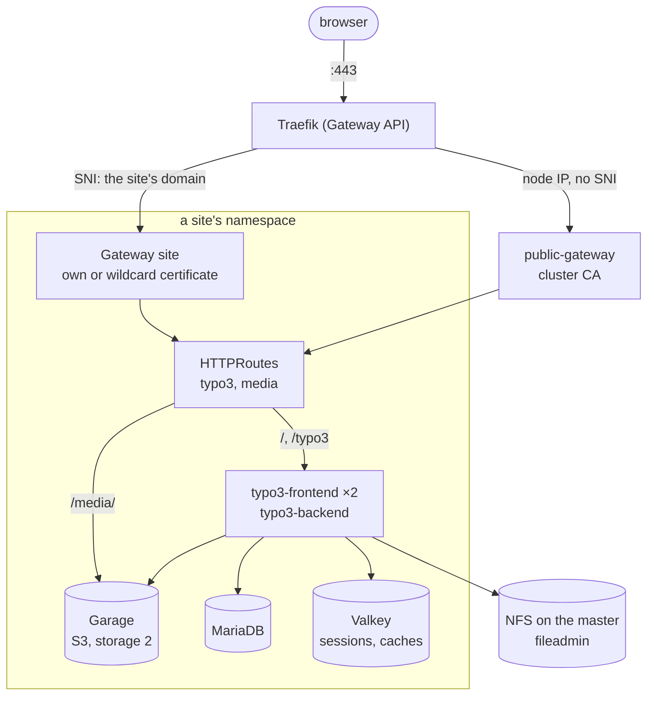
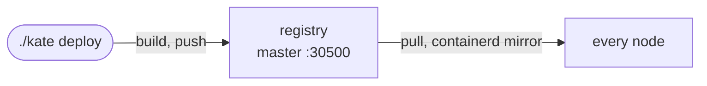

# TYPO3 architecture

## Where it comes from

The TYPO3 layer is taken from [bmack/typo3-k8s-starter](https://github.com/bmack/typo3-k8s-starter) by Benni Mack (MIT, upstream commit `2b88541`, 2026-11-26). Benni's repo develops in DDEV and rehearses in a k3s container next to DDEV. Here the same image and chart run on the libvirt cluster, with the database and caches inside the cluster.

| Taken unchanged | Purpose |
|---|---|
| `k8s/charts/typo3/` | Helm chart: frontend and backend Deployments, migrations Job (Helm hook), scheduler CronJob, HPA, PDB, HTTPRoute, NetworkPolicy, hardened pods |
| `config/system/additional.php`, `kubernetes.php`, `file-storages.yaml` | all configuration from `TYPO3_*` environment variables |
| `packages/k8s-health` | `/_health/live` and `/_health/ready` (database + Valkey) |
| `packages/k8s-starter` | site package (Site Set `bmack/k8s-starter`) |
| `projects/kate/composer.json`, `composer.lock` | TYPO3 v15 (`dev-main`), b13 S3 driver, stderr logging, distributed locks; moved into `projects/kate/`, path repository `../../packages/*` |
| `docker/php/` | PHP settings of the image |

| Adapted | Change |
|---|---|
| `k8s/platform/mariadb.yaml` | from `examples/mariadb`: 1 replica instead of 3, 1 GiB, local-path storage, no metrics |
| `k8s/platform/valkey.yaml` | from `examples/valkey`: cache limited to 256 MB |
| `k8s/platform/storage.yaml` | from `examples/storage`: StorageClass `nfs` |
| `k8s/platform/garage.yaml` | new: Garage v2.6 single node for storage 2. TYPO3 reaches its S3 API through the chart's own NetworkPolicy (`networkPolicy.extraEgress` in `k8s/values/cluster.yaml`); the `/media/` route comes from `./kate manifests` |
| `infra/templates/gateway.yaml.tftpl` | from `examples/gateway`: Traefik's Gateway API provider, `public-gateway` for the node IPs with a certificate from the cluster CA. Sites with a domain get their own Gateway and cert-manager certificate |
| `docker/Dockerfile` | FrankenPHP 1 / PHP 8.5 image (UID 1000, port 8080, read-only filesystem), plus the `prepare-settings.php` step. Built per site with `--build-arg PROJECT=<name>`: keeps the repository layout under `/src` so `../../packages/*` resolves, copies path packages instead of symlinking them, adds the shared `config/system/`, and refuses a site with its own `config/system/` |
| `k8s/values/cluster.yaml` | from `values/production.yaml`: our hosts, Secret, services, volumes, Mercure on |
| `k8s/charts/typo3/` | messenger worker on by default; optional Mercure hub (`mercure.enabled`) with its route under `/.well-known/mercure` and NetworkPolicy |

| New | Why |
|---|---|
| `projects/<name>/` | several sites from one repository, each with its own `kate.yaml`, Composer files and namespace |
| `projects/kate/config/sites/main/config.yaml` | In Benni's repo, `ddev setup` creates it. Here it is versioned, so the image contains it. |
| `./kate deploy` | the counterpart of his `ddev k8s-deploy`, for a real cluster, one site at a time |
| `./kate values`, `./kate manifests` | per site: Helm values from the domain, Gateway `site`, Certificate `site`, `/media/` route |
| `k8s/bootstrap.sql` | root page and sample pages (his `seed.sql` expects the root page from `typo3 setup`) |
| `docker/prepare-settings.php` | brings `settings.php` up to date at build time, see below |
| `packages/k8s-health` (extended) | besides the probes: Valkey, messenger worker (heartbeats in `tx_k8shealth_messenger_worker`) and queue in the backend's System Information menu |

## Platform (set up by `infra/`)

A request, and where the site's data lives:

How an image gets to the nodes:

| Component | Installed by | Notes |
|---|---|---|
| Registry | k3s manifest, `registry:3` on the master | plain HTTP. Every node has a containerd mirror for it |
| RWX storage | `nfs-kernel-server` on the master + `csi-driver-nfs` | StorageClass `nfs`, `reclaimPolicy: Retain` |
| Gateway API | k3s ships the CRDs; Traefik's provider is switched on | GatewayClass `traefik`, Gateway `gateway-system/public-gateway`: `https` on the node IPs for routes from the namespace labelled `gateway-access: public`, `http` only redirects. Each site with a domain has its own Gateway `site` (`./kate deploy`) |
| TLS | OpenTofu `tls` provider: cluster CA + certificate for all node IPs | Secret `gateway-tls`, also Traefik's default certificate (`TLSStore default`), because browsers send no SNI for IP addresses |
| Let's Encrypt | cert-manager, the Hetzner DNS webhook, ClusterIssuers with one DNS-01 solver per provider in `acme.providers` (while `acme:` is in `kate.yaml`) | each site's Certificate `site` in its namespace, or the shared wildcard Certificate in `gateway-system` for sites under `acme.wildcard`; Traefik picks it by SNI |
| mariadb-operator | HelmCharts `mariadb-operator-crds` + `mariadb-operator` | namespace `mariadb-system` |

## Why `settings.php` is prepared at build time

Benni's image has a read-only, environment-free `settings.php`: "TYPO3 never writes this file at runtime." On a fresh database, the migrations Job broke that rule twice:

1. `extension:setup` writes the default configuration of every extension that has an `ext_conf_template.txt`, whenever it is missing from `settings.php`.
2. `upgrade:run` applies TYPO3's silent configuration upgrades. The first one generates an encryption key whenever the **file** has none, even though `kubernetes.php` sets the real key from the environment.

`docker/prepare-settings.php` runs in the image build, boots TYPO3 without a database and applies both, until nothing is left to change. `docker/settings.php` carries the placeholder `set-from-env-TYPO3_ENCRYPTION_KEY`, so no real key is generated into the image. `kubernetes.php` always replaces the placeholder with `TYPO3_ENCRYPTION_KEY`.

## Why the first install is a separate pod

In TYPO3 v15, `extension:setup` authenticates the CLI user first, so it needs `be_users` to exist. It can update a database but not create one. The deploy script therefore runs `typo3 setup` once, in a pod with the same image, when `be_users` is missing. `setup` writes its own `settings.php`, so the pod gets a writable copy of `config/system` that is thrown away with the pod.

## Secrets

Created once per site, in its namespace, by the deploy script, never stored in git or Helm:

| Secret | Keys |
|---|---|
| `typo3-env` | `TYPO3_ENCRYPTION_KEY`, `TYPO3_DB_PASSWORD`, `TYPO3_VALKEY_PASSWORD` (all TYPO3 pods via `envFrom`) |
| `typo3-mariadb` | `root-password`, `typo3-password` |
| `typo3-valkey` | `password` |
| `typo3-admin` | `username`, `password` of the backend admin |
| `typo3-garage` | Garage RPC secret, admin token, S3 access key and secret (the key pair is also in `typo3-env`) |

## Resource budget

Requests of one site, on the two workers (6 GiB each):

| Workload | CPU | Memory |
|---|---|---|
| frontend ×2 | 400m | 768 Mi |
| backend | 100m | 384 Mi |
| messenger | 50m | 256 Mi |
| scheduler (CronJob) | 50m | 256 Mi |
| MariaDB | 500m | 1 Gi |
| Valkey + cache | 150m | 704 Mi |
| Garage | 50m | 128 Mi |
| Mercure | 20m | 32 Mi |
| **total** | **1.32 CPU** | **≈ 3.5 GiB** |

Headlamp, the operators and the platform components come on top. How many sites fit: [Odroid H2 host](../guide/odroid#several-sites).

## Not done yet

- **Backups:** `examples/mariadb/02-backups.yaml` (mariadb-operator Backup CR) isn't applied.
- **High availability:** MariaDB, Valkey and Garage run as single instances.
